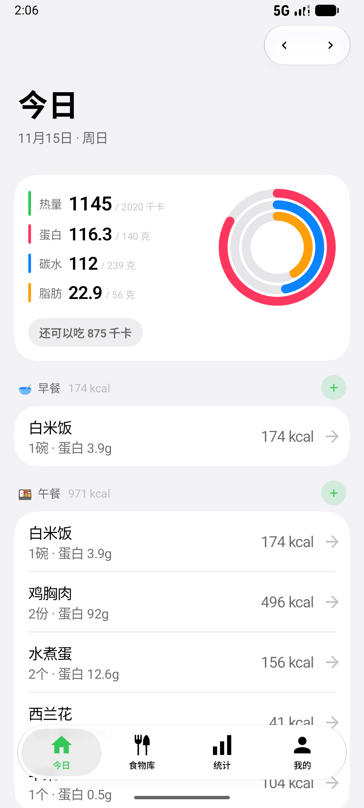
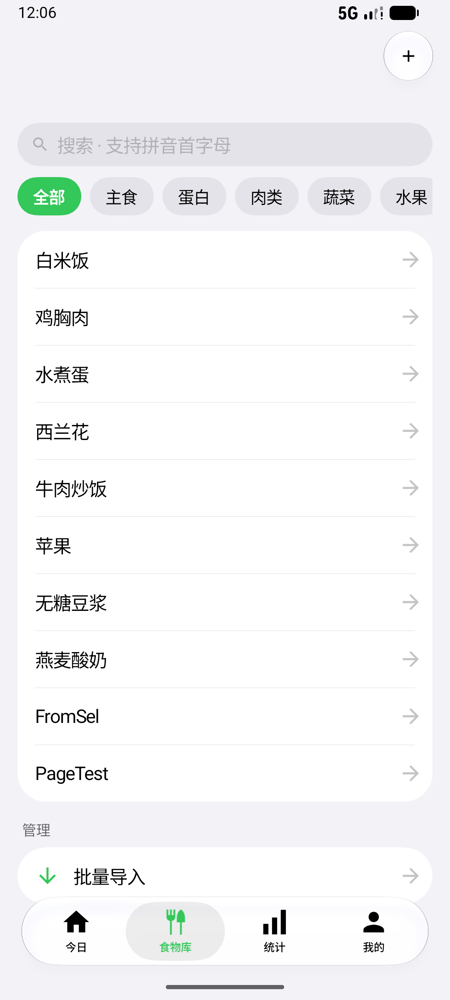
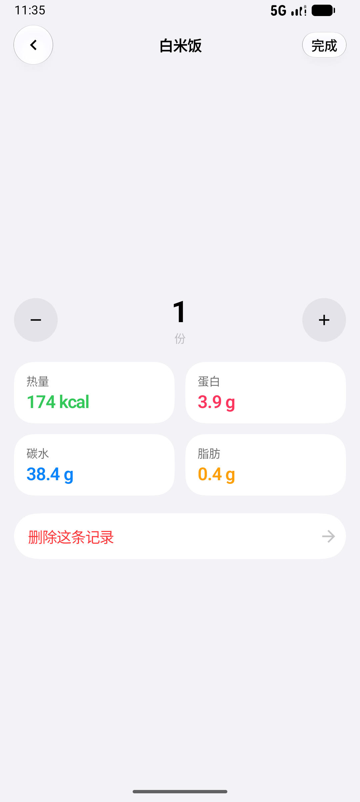
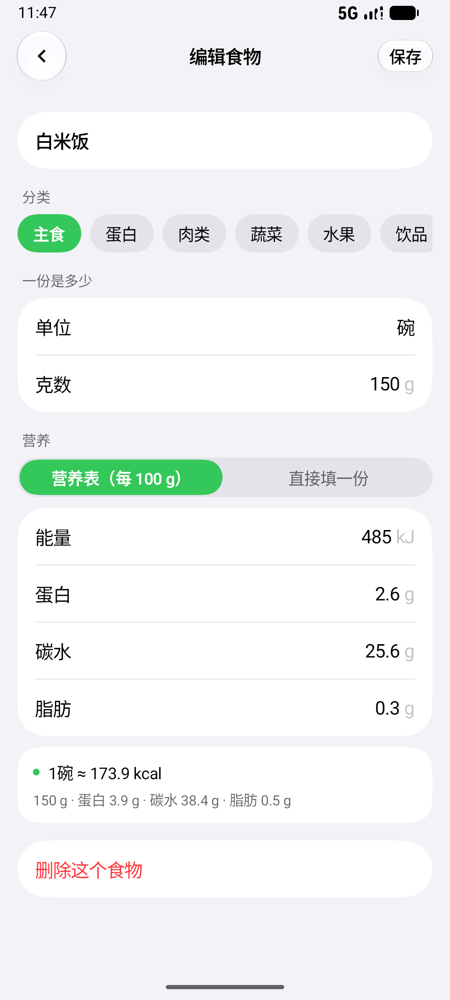

# FitLog

完全本地、无账号的 Android 饮食与体重记录 App。界面用 Jetpack Compose + [Glasmio](https://github.com/neoruaa/glasmio) 做成 iOS「液态玻璃」风格，数据只保存在本机。

## 功能

- **今日**：热量 / 蛋白 / 碳水 / 脂肪四圈同心环，四餐分组，前后翻日期，复制昨天的记录
- **记录**：搜索食物（中文或拼音首字母）、分类筛选、份量步进；记录页四项营养各一张卡片
- **食物库**：按营养表录入（能量填 kJ、每 100 g）自动折算成一份，支持批量粘贴导入
- **统计**：月历标出每天热量、当日详情环图、体重趋势与记录
- **我的**：目标（只读）、设置（修改资料、备份地址、导出 / 导入备份）
- 支持 JSON 备份；可以固定一个备份目录，之后导出不再每次选位置

## 截图

| 今日 | 食物库 | 记录 |
| --- | --- | --- |
|  |  |  |

| 编辑食物 | 统计 | 设置 |
| --- | --- | --- |
|  |  |  |

## 构建

```bash
./gradlew assembleDebug      # 调试包
./gradlew assembleRelease    # 发布包（debug 签名，供本地安装）
```

需要 JDK 17+ 与 Android SDK 37（minSdk 33）。数据层只是「一份 JSON 存在 DataStore 里」，没有服务端依赖。
