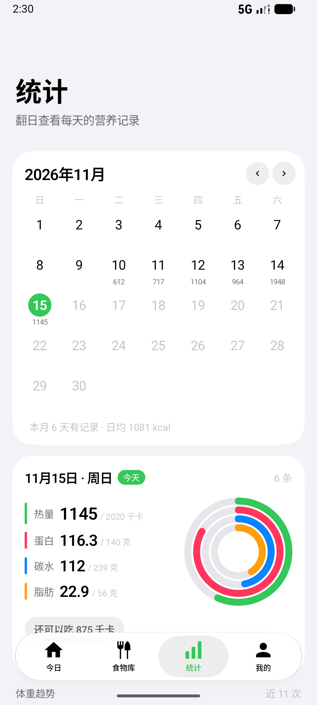
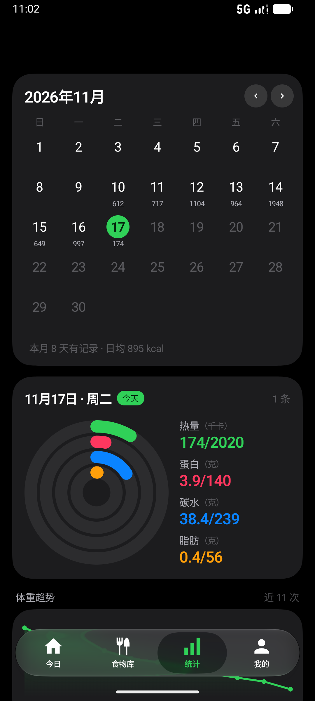
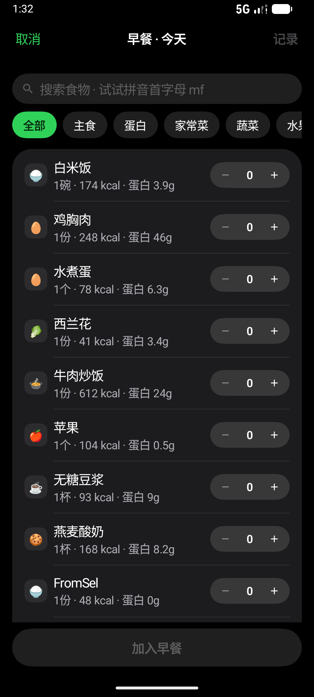
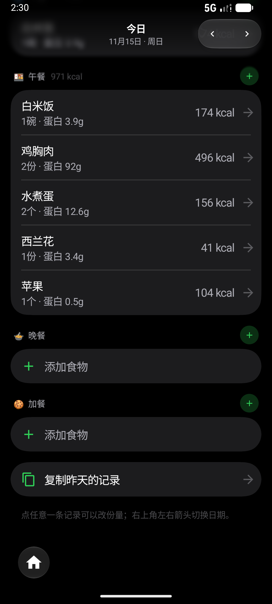
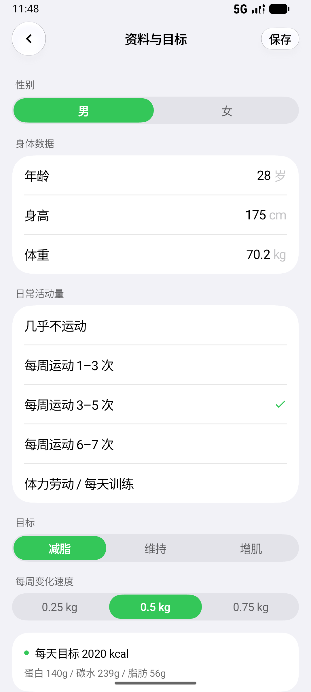
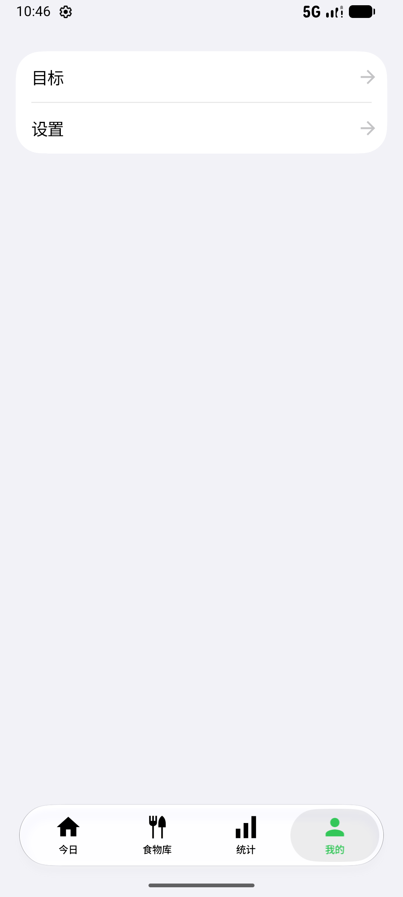
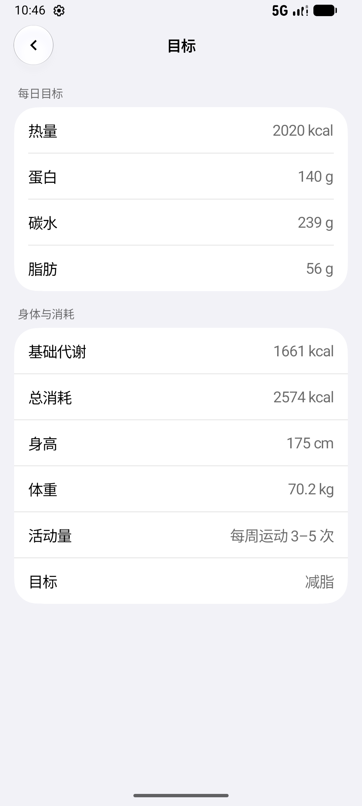
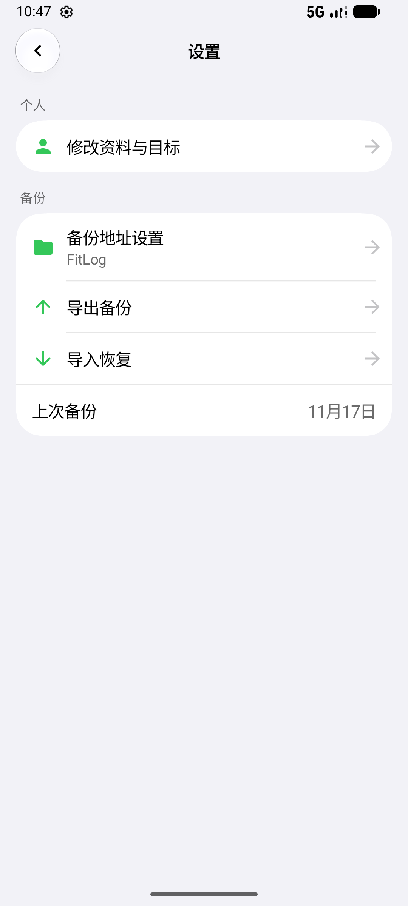
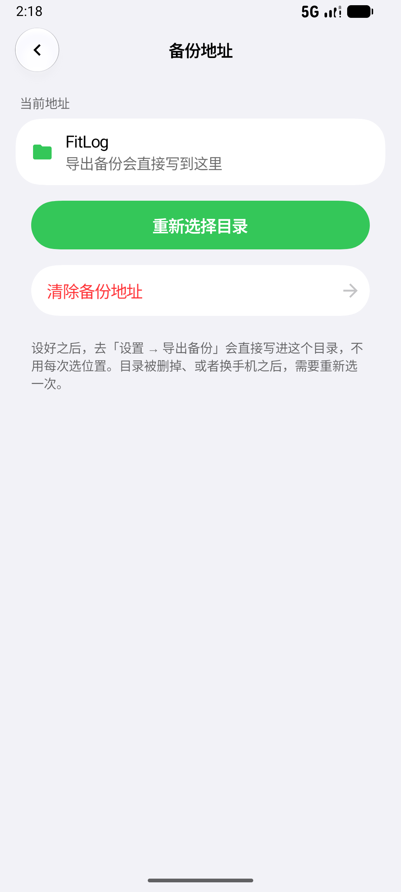
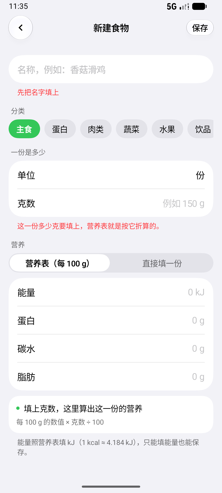

# FitLog · 安卓版

自用的本地饮食记录 App。纯离线，数据只放在手机里，不联网、不登录、没有网络权限。

原生 Kotlin + Jetpack Compose，界面是 **iOS 液态玻璃（Liquid Glass）风格**：
大标题 + 分组列表 + 悬浮玻璃底栏，滚动时底栏和标题栏会像 iOS 一样收缩、模糊、透出底下的内容。

- **工程位置**：`D:\AndroidProjects\FitLog`
- **包名**：`com.fitlog.app`
- **当前版本**：1.0（versionCode 1）

| 今日（浅色） | 统计 | 食物库 |
|---|---|---|
|  |  |  |

| 统计（深色） | 选择食物（深色） | 滚动后的收缩态 |
|---|---|---|
|  |  |  |

---

## 一、环境

| 项 | 版本 / 位置 |
|---|---|
| Android Studio | `D:\android studio` |
| JDK | Studio 自带 JBR 25（`D:\android studio\jbr`） |
| Android SDK | `D:\Android\Sdk`（已从 C 盘迁出，写在 `local.properties`） |
| SDK Platform | API 37（Android 17） |
| build-tools | 36.0.0 |
| Gradle | 9.9.1（wrapper 自动下载，已配腾讯镜像） |
| AGP | 9.5.1 |
| Kotlin | 2.4.21 |
| Compose BOM | 2026.09.00 |
| 液态玻璃 UI | [Glasmio](https://github.com/NEORUAA/Glasmio) 0.1.3 |
| minSdk / targetSdk | 33 / 37 |

> **路径已全部落在 D 盘**，C 盘不再保存任何 Android 编译产物：
>
> | 内容 | 位置 | 靠什么变量定位 |
> |---|---|---|
> | Android SDK | `D:\Android\Sdk` | `ANDROID_HOME` / `ANDROID_SDK_ROOT`（用户环境变量） |
> | 模拟器实例 | `D:\Android\avd` | `ANDROID_AVD_HOME`（用户环境变量） |
> | Gradle 依赖缓存 | `C:\Users\ASUS\.gradle` | 系统约定，删除后自动重建 |
>
> **换电脑时要改两处**：`local.properties` 里的 `sdk.dir`（或直接删掉这个文件让 Studio 重新生成），
> 以及上面三个环境变量。
>
> `minSdk` 是 **33** 而不是更低的 26：Glasmio 的 AAR 清单强制要求 33，
> 它的折射/模糊管线本身也依赖 API 31+ 的 `RenderEffect` / `RuntimeShader`。

---

## 二、第一次打开

1. Android Studio → **File → Open** → 选 `D:\AndroidProjects\FitLog`
   （选这个根目录，**不要**选里面的 `app`）
2. 等右下角 Gradle 同步跑完。首次要下依赖，约 5–10 分钟；之后打开是秒同步。
3. 顶部选设备：
   - **真机**：手机「设置 → 关于手机 → 连点版本号 7 次」→ 开发者选项 → USB 调试 → 插线并在手机上允许调试
   - **模拟器**：Device Manager → Create Device，选 API 37，**Graphics 必须选 `Hardware - GLES 2.0` 或 Vulkan**
     （选 SwiftShader 软件渲染会黑屏，见第八节）
4. 点绿色 ▶ 运行（`Shift + F10`）

---

## 三、UI 是怎么搭的

整套视觉效果来自 **Glasmio**（Apache-2.0，Java/Kotlin + 少量 C++），它把 iOS 26/27 的
玻璃材质、控件、动画和交互在 Android 上重做了一遍。我们只负责「内容」和「品牌色」。

### 1. 三层结构

`ui/FitLogApp.kt` 就是全部骨架：

```kotlin
FitLogTheme {                       // 主题：GlasmioTheme + FitLog 品牌色
    GlasmioIconProvider {           // 图标：SF Symbols 没有字体时回退到 Material
        GlasmioBackdropHost(
            sampledContent = { /* 当前页面：被录制成玻璃的采样源 */ },
            overlayContent = { /* 玻璃底栏 + Toast */ },
        )
    }
}
```

关键点是 **「玻璃不能采样到自己」**：页面的普通内容放 `sampledContent`，
所有玻璃控件（底栏、Toast）放 `overlayContent`。所以页面内部不要再放
`GlasmioButton` / `GlassSurface` 这类采样背景的控件，否则会形成反馈环路（画面会糊成一团）。

### 2. 页面

每个 Tab 都是一个 `GlasmioPinnedListPage`：

- 大标题 + 副标题，滚动到阈值后自动收进顶部工具栏（弹簧动画）
- 顶部工具栏带渐进模糊，页面内容从下面滚过时会被磨砂
- `actions` 槽放玻璃按钮（今日页的左右箭头、食物库的加号）
- 内容用 `GlasmioGroupedList` + `GlasmioListRow`，就是 iOS「设置」那种分组表格

底部是 `GlasmioNavigationBar`：四个 Tab 的玻璃胶囊 + 选中项的透镜。
列表向下滚 64dp 后会自动收缩成左下角一个小圆，点一下再展开。

### 3. 二级页面（原弹层）

选择食物 / 新建食物 / 编辑记录 / 批量导入 / 资料，五个二级页面都渲染在
**采样层里**（和标签页同一个窗口），不再用 Dialog：

- 页面外壳直接用 Glasmio 的 `GlasmioPinnedPage`：**玻璃导航栏**（返回键 + 操作按钮）、
  标题居中，内容滚到顶栏下面时做渐进模糊（和「今日」「食物库」同一套材质）
- 表单用分组列表 + `FieldRow`，分类用胶囊，二选一用 `SegmentedRow`
  资料页长这样：

  

- 进出场：水平推入 280ms（`FitLogApp.SheetPageArea`），退场 220ms；页面打开时底栏隐藏
- 页面在采样层里，`GlasmioPinnedPage` 自带「内容导出到独立背景、顶栏再采样它」的分层，不会形成反馈环路
- 「我的」是两级结构：一级只有「目标」「设置」，设置里再进「修改资料与目标」「备份地址」两个三级页面
- 删除食物 / 导入确认：`GlasmioAlertDialog`（1.2× 缩放进场，和 iOS 一样）

| 我的（一级） | 目标 | 设置 | 备份地址 |
|---|---|---|---|
|  |  |  |  |

### 4. 品牌色与图标

- 强调色：`ui/theme/Theme.kt` 的 `FitPalette.accent()`，现在取 iOS 系统绿
  （浅色 `#34C759` / 深色 `#30D158`）。改这一个函数，整站按钮、选中态、图表全跟着变。
- 宏量配色：`FitPalette.protein / carbs / fat`（红蓝橙），超出目标时自动转红。
- 底栏两个图标（刀叉、柱状图）是 `ui/FitIcons.kt` 里手写的 `ImageVector`。
  原因见下一节：Glasmio 的底栏只接受 `SfSymbol` 枚举，而苹果的符号字体不能随包分发。

### 5. 为什么不带 SF Symbols 字体

Glasmio 的 `SfIcon` 在没有提供字体时会走 `GlasmioIconResolver` 回退到 Material 图标，
分发 SF Pro / SF Symbols 需要苹果授权，所以这里不打包字体，只把两个「语义最不贴」的
底栏图标换成自绘矢量。其余图标（加号、垃圾桶、日历、箭头……）都用 Glasmio 内置的回退表。

---

## 四、怎么调试

### 1. 断点调试（最常用）

- 代码行号左侧点一下 → 出现红点就是断点
- 顶部把运行配置从 **Run** 切成 **Debug**（小虫子图标），或按 `Shift + F9`
- 停在断点时：
  - `F8` 单步跳过、`F7` 单步进入、`Shift + F8` 跳出
  - `Alt + F8` 打开表达式求值，可以现场改值、调函数
  - `Variables` 面板能展开 `data`、`ui` 这些状态对象看内部字段
- 应用已经在跑、想临时接入：**Run → Attach Debugger to Android Process** → 选 `com.fitlog.app`

**建议先在这几个地方下断点**，能把整条数据流串起来：

| 位置 | 看什么 |
|---|---|
| `AppViewModel.commitSelection` | 一顿饭入账时，份量怎么变成记录条目 |
| `AppViewModel.saveFoodForm` | 保存食物时怎么校验、id 怎么生成 |
| `AppRepository.mutate` | 每次写入前的完整 `AppData` 快照 |
| `domain/Calc.kt` 的 `targetsOf` | 目标热量是怎么算出来的 |

### 2. Compose 界面预览（改样式不用装手机）

`ui/Previews.kt` 里有 6 个预览：今日概览（深浅色 + 超标）、历史日历、当日详情、体重折线。

- 打开这个文件，右上角切到 **Split** 或 **Design**，右侧就是模拟画面
- 只预览**不依赖玻璃采样**的零件。整页预览需要 `GlasmioBackdropHost` 的录制层，
  Studio 预览渲染不出来，这部分只能跑模拟器/真机看。

### 3. 看界面层级和重组次数

**Tools → Layout Inspector**（应用运行时才能用）：

- 看每个 Composable 的边界、尺寸、实际生效的 modifier
- 勾上 **Show Recomposition Counts**：改一处数据后某个节点重组了几十次，就是那里该加 `remember` 了
- 玻璃控件每帧都在重新采样，重组次数比其他页面高是正常的；看 `sampledContent` 那一层才有意义

### 4. 看日志

`Logcat` 面板（底部工具栏那只猫）：

- 过滤栏输入 `package:com.fitlog.app`，只看这个应用
- 崩溃一定从这里看：搜 `FATAL EXCEPTION`，下面 `Caused by` 那行才是根因
- 玻璃渲染失败通常**不会崩**，只会黑一块，见第八节

### 5. 性能

**Run → Profiler**：CPU 看主线程卡在哪，Memory 看有没有泄漏。
玻璃材质是逐帧采样的，低端机上更吃 GPU；调试时可以在 `GlasmioTheme` 里临时加
`appearance = GlassAppearance(reduceTransparency = true)` 关掉折射对比帧率。

### 6. 清空数据重新来一遍

```bash
# 方式一：清空应用数据（最干净，等于刚安装）
adb shell pm clear com.fitlog.app

# 方式二：只删数据文件，保留应用
adb shell run-as com.fitlog.app rm -f files/datastore/fitlog.preferences_pb

# 方式三：直接看数据文件（就是一份 JSON，能肉眼核对）
adb exec-out run-as com.fitlog.app cat files/datastore/fitlog.preferences_pb
```

在 Studio 里也能看：**View → Tool Windows → Device Explorer** →
`data/data/com.fitlog.app/files/datastore/fitlog.preferences_pb`，右键 Save As 导出。

---

## 五、命令行也行

工程自带 Gradle Wrapper，不装 Gradle 也能跑：

```bat
cd /d D:\AndroidProjects\FitLog

rem 构建 debug 包，产物在 app\build\outputs\apk\debug\app-debug.apk
gradlew.bat assembleDebug

rem 直接装到已连接的设备
gradlew.bat installDebug

rem 构建一个可以直接安装的 release 包（用 debug 签名，自用方便）
gradlew.bat assembleRelease
adb install -r app\build\outputs\apk\release\app-release.apk

rem 跑单元测试
gradlew.bat testDebugUnitTest
```

> **日常用请装 release 包。** debug 包里 Compose 基本跑在解释执行下，
> 滚动这种每帧采样玻璃的界面会明显更涩；同样的代码 release 包顺得多。
> 体积也会从 ~75 MB 降到 ~56 MB。

用 Git Bash 就把 `gradlew.bat` 换成 `./gradlew`，并先指定 JDK：

```bash
export JAVA_HOME="/d/android studio/jbr"
```

---

## 六、目录结构

```
D:\AndroidProjects\FitLog\
├── settings.gradle.kts            工程名与模块声明
├── build.gradle.kts               根构建脚本（含 KGP 版本抬升，见第七节）
├── gradle.properties              Gradle 内存与缓存开关
├── local.properties               SDK 路径（本机专用，不进版本库）
├── .gitignore / .gitattributes    生成物、行尾规则
├── docs\screenshots\              README 里的截图（7 张）
├── gradle\
│   ├── libs.versions.toml         所有依赖版本集中在这里（含 glasmio）
│   └── wrapper\                   自带 Gradle 9.9.1
└── app\
    ├── build.gradle.kts           模块配置：SDK 版本、依赖
    ├── proguard-rules.pro
    └── src\
        ├── main\
        │   ├── AndroidManifest.xml
        │   ├── java\com\fitlog\app\
        │   │   ├── MainActivity.kt            入口，只负责挂载 Compose
        │   │   ├── data\
        │   │   │   ├── Models.kt              数据模型（字段与网页版 JSON 一致）
        │   │   │   ├── AppCodec.kt            AppData ↔ JSON，导入容错
        │   │   │   └── AppRepository.kt       DataStore 持久化，原子读改写
        │   │   ├── domain\                    纯逻辑，不依赖 Android，可直接单测
        │   │   │   ├── Calc.kt                TDEE / 三大宏量 / 汇总
        │   │   │   ├── Dates.kt               日期工具
        │   │   │   ├── Nutrition.kt           每 100 g ↔ 每份、kJ ↔ kcal 折算
        │   │   │   ├── Pinyin.kt              首字母检索（mf → 米饭）
        │   │   │   └── BatchImport.kt         批量粘贴解析
        │   │   └── ui\
        │   │       ├── AppViewModel.kt        唯一状态源，所有操作都走这里
        │   │       ├── FitLogApp.kt           根：主题 + 采样宿主 + 底栏 + 二级页面
        │   │       ├── FitIcons.kt            底栏两个自绘图标 + 图标解析器
        │   │       ├── Previews.kt            Studio 组件预览
        │   │       ├── theme\Theme.kt         Glasmio 主题 + FitLog 品牌色
        │   │       ├── components\
        │   │       │   ├── IosPrimitives.kt   iOS 零件：分组标题、搜索框、表单行、
        │   │       │   │                      分段控件、按钮、同心圆环、体重折线
        │   │       │   └── HistoryCalendar.kt 月历 + 选中日期的营养详情
        │   │       ├── screens\               今日 / 食物库 / 统计 / 我的（只有目标/设置两个入口）
        │   │       └── sheets\                二级页面：选择食物 / 食物表单 / 记录份量 /
        │   │                                  批量导入 / 资料 / 我的-目标 / 我的-设置 / 备份地址
        │   └── res\                           图标、主题、颜色
        └── test\java\com\fitlog\app\
            └── DomainTest.kt                  17 条单元测试
```

---

## 七、设计上的几个决定

- **UI 用 Glasmio，不自己画玻璃。** 液态玻璃的折射、色散、高光、阴影是一整套
  运行时着色器管线（AGSL + RenderEffect），自己实现要写几千行 native 代码，
  还得逐帧对齐 iOS。Glasmio 已经把这套做完了，而且控件、动画、交互一起给了。
- **页面内容与玻璃分层。** 只有导航栏、工具栏是玻璃；页面里的卡片用
  iOS 分组列表的实色底。这不是偷懒——玻璃控件如果采样到自己所在的那一层，
  反馈环路会让画面糊掉（Glasmio 文档里也明确要求分层）。二级页面用 `GlasmioPinnedPage`，
- **没有用 Room。** 这个数据量（几百种食物、几年记录）一份 JSON 完全够，
  换来的是导出、导入、换机迁移都只是读写一个文件，调试时也能直接 `cat` 出来看。
- **图表还是自己画的。** 柱状图、折线图、四圈同心环都是 `Canvas`，
  没引图表库；图标只有两个是自绘矢量，其余复用 Glasmio 的 Material 回退表。
- **状态只有一份。** `AppViewModel` 持有 `AppData` 和界面状态，Compose 单向订阅，
  不会出现「某个角落的数据忘了刷新」。
- **没有用 Hilt。** 就一个 `AppViewModel`，手动 `viewModelFactory` 注入 Repository，
  加个 DI 框架纯属给自己添麻烦。
- **与网页版数据互通。** 导出的 JSON 结构和之前那版网页 PWA 完全一致，
  浏览器里的备份可以直接「我的 → 导入恢复」，反过来也能拿到网页版用。
- **「每 100 g」只是输入方式，存档永远按一份。** 营养表折算发生在界面和
  `domain/Nutrition.kt` 里，写进 `Food.kcal/p/c/fat` 的始终是折算后的一份数值，
  `gram` 只负责当初的折算依据。好处是今日页、统计页、备份 JSON 都不用知道
  用户是怎么录的，旧备份也不用迁移；代价是编辑时要把一份值反推回每 100 g，
  所以两个方向都得有单测（往返不能走样）。
- **能量按 kJ 输入、按 kcal 记账。** 国内营养表一律写「能量 kJ」，用户照抄最省事；
  但 TDEE、热量环、余量这些概念全是 kcal，全站统一用 kcal 才好比较。所以只在
  `FoodForm` 这一层做 `1 kcal = 4.184 kJ` 的换算，存档里没有 kJ 字段，
  网页版备份也不用跟着改。输入框显示 kJ 时取整（营养表本来就是整数），
  顺手把「填 690、回填成 689.9」这种一位小数抖动抹掉。
- **今日页和统计页共用一套「四圈环 + 四组数值」。** 抽成了 `NutritionRingsBody`，
  两张卡只是外套不同：今日页没有表头，统计页多一行「日期 + 今天 + 几条」。
  环在左、数值在右，数字直接染成对应的环色（热量绿、蛋白粉、碳水蓝、脂肪橙），
  热量是最外圈——顺序和右边四行一致，扫一眼就能对上。
  统计页不再重复「各餐吃了多少」，今日页也不再单独放「还可以吃多少」的胶囊：
  环和分数已经说明问题，多一行字只会把卡片撑长。改一处两边一起变。

**关于 `build.gradle.kts` 里那行 `buildscript classpath`：**
AGP 9.0 起内置 Kotlin 支持，**不再需要** `org.jetbrains.kotlin.android` 插件；
但它内置的 KGP 只有 2.2.10，而依赖是按 2.4.x 编译的，元数据版本对不上就会报一屏
`Unresolved reference`。所以必须显式把 KGP 抬到 2.4.21。**这行别删。**

---

## 八、功能

| 模块 | 内容 |
|---|---|
| 今日 | 四圈同心环（外到内：热量/蛋白/碳水/脂肪）+ 右侧同序数值、超出目标变红、四餐分组、前后翻日期、复制昨天 |
| 记录 | 搜索（中文 / 拼音首字母）、分类筛选、份量步进、一顿汇总后一次入账、删错了可以撤销 |
| 食物库 | 新建/编辑/删除、七个分类、按使用频次排序、按营养表（能量填 kJ、每 100 g）+ 实际克数自动折算、批量粘贴导入（支持 `485kj`）、空库引导建第一个 |
| 统计 | 月历（每天标出当日热量，可一直往回翻）、点某天看当日详情（与今日页同一套四圈环，不重复列餐次）、体重折线、记体重 |
| 我的 | 一级只有「目标」「设置」两行（无标题、图标、副标题）；目标页只读展示每日目标（蛋白/碳水/脂肪各一行，身高体重分两格）与身体消耗；设置页放修改资料、备份地址、导出/导入和上次备份时间 |
| 体验 | 深浅色跟随系统、大标题随滚动收起、底栏随滚动收缩、二级页面玻璃顶栏 + 水平推入、键盘弹起时表单自动上移 |

### 用起来要知道的三件事

1. **食物库是空的，得自己建。** 这是当初刻意不做预置数据的结果——
   只录自己真吃的东西，选的时候才快。
2. **照着营养表填就行，不用自己换算。** 包装上写的是「能量 690 kJ / 每 100 g」，
   新建食物时把 kJ 和三项宏量照抄进去，再填这一份实际多重（比如 150 g），
   下面会实时给出「1 份 ≈ 247 kcal · 蛋白 18 g」，保存后 App 里按一份、按 kcal 记账。
   早年按「一份」直接记、没有克数的食物，编辑时切到「直接填一份」即可。
3. **数据只在这台手机上。** 卸载应用会一起删掉，记得「我的 → 导出备份」，
   文件存到你选的位置（网盘目录最稳）。

| 按每 100 g 营养表录入（能量填 kJ） | 缺克数时提示写在表单里 |
|---|---|
|  |  |

---

## 九、已知限制 / 以后想加

- **必须 API 33+，且需要硬件 GPU。** Glasmio 用 `RuntimeShader` 做折射，
  模拟器用 SwiftShader（软件渲染）时会黑屏——不是 App 崩了，是玻璃画不出来。
  模拟器启动参数加 `-gpu host` 即可。
- 没做三餐定时提醒。要加的话是 `WorkManager` + 通知权限，半小时的活。
- 没做「我的套餐」（一组常吃食物一键记）。用一段时间觉得需要再加。
- **包体偏大**：Glasmio 自带 Material 图标全集和几种 ABI 的 native 库。
  debug ~75 MB、release ~56 MB；真要分发时开 `isMinifyEnabled` + ABI 分包会小很多。
- 没做 release 签名配置。现在只有 debug 包，自己用够了；要正式分发再生成 keystore。

---

## 十、验证记录

跑在 `Medium_Phone_API_37`（1080×2400 @420dpi，`-gpu host`）上逐项点过：

| 验证项 | 结果 |
|---|---|
| 首次启动 | 自动打开「资料与目标」二级页面；取消后不再反复弹 |
| 四个 Tab | 今日 / 食物库 / 统计 / 我的 都能切，选中胶囊和页面一致 |
| 大标题收起 | 向上滚动后标题收进工具栏、顶部渐进模糊生效 |
| 底栏收缩 | 滚动 64dp 后收成左下角小圆，点一下展开 |
| 选择食物 → 记录 | 步进到「已选 1 份 · 约 104 kcal」，入账后今日页晚餐多出一条 |
| 今日概览 | 环在左、四组数值在右：热量 649/2020 千卡、蛋白 24.3/140 克、碳水 112/239 克、脂肪 12.1/56 克；超标时对应那一项的数值和环一起转红 |
| 新建 / 编辑食物 | 分类胶囊、单位、克数、四项营养都能存；删除前有确认弹窗 |
| 按营养表录入 | 白米饭 能量 485 kJ/100 g × 150 g → 1 份 174 kcal；鸡胸肉 690 kJ + 12/60/3 g × 150 g → 247 kcal；改口径（每 100 g ↔ 每份）时数字跟着换算 |
| 能量单位 | 表单填 690 kJ，存成 247.4 kcal，再打开回填 690 kJ（取整显示，不抖成 689.9） |
| 表单校验 | 缺名字 / 缺克数时提示直接写在对应栏下方（不依赖 toast，页面里也能看见） |
| 非法输入 | 能量填 `12.5.3` 保存时红字提示「营养值只能填数字」，不会再静默存成 0 |
| 删除记录 | 删掉一条后提示条右侧出现「撤销」，几秒内点一下能原位恢复（不是排到最后） |
| 二级页面打开 | 同条件首帧：新建食物 350 ms（原 Dialog 弹窗 750 ms，其中 layout 467 ms）；选择食物/记录份量/批量导入/资料 全部按页面打开，含键盘弹起 |
| 圆环单位 | 数值行只放「已吃/目标」，单位挪到标签行「热量（千卡）」；字体调大、窄屏都不会再把单位挤出卡片 |
| 每周速度 | 0.25 / 0.5 / 0.75 三档都能选中并高亮（之前 0.75 因为 `trimNumber` 四舍五入成 0.8 永远选不中） |
| 跨零点 | 挂后台跨天回来，停在「今天」时自动顺延到新的一天；手动翻到历史日期则保持不动（判断逻辑有单测） |
| 导入校验 | `{}`、随便一个 JSON 都会被拒绝；只有含 foods/logs/weights/profile/meta 的才允许导入 |
| 我的层级 | 一级只有目标/设置；设置 → 修改资料与目标 / 备份地址 都是三级页面，返回键和顶栏返回都回到设置；保存资料后也回到设置 |
| 备份地址 | SAF 选目录并持久化授权，页面显示目录名；「导出备份」直接写入该目录（`fitlog-2026-11-17-0217.json`），不再弹选择器；上次备份同步更新 |
| 批量导入 | 一行一条粘贴，导入后分类默认「主食」；`326kj` 这类写法按 kJ 换算，裸数字仍按 kcal |
| 统计 | 月历显示每天热量、可翻月；点某天显示当日四圈环详情（与今日页同一套）；体重折线 11 个点 |
| 记体重 | 单次记录后折线更新，「我的」里的身高体重同步 |
| 深浅色 | 两套色板都正常，状态栏图标随之反色，玻璃材质自动换配方 |
| 导入 / 导出备份 | JSON 结构与网页版一致，导入可完整还原 |

单元测试 17 条全过（`gradlew testDebugUnitTest`）：热量目标与网页版一致、女性目标下限、
拼音检索、批量导入（含逗号写法与默认分类/拼音别名、带 `kj` 的能量列）、份数累加、
备份 JSON 往返、网页版空 `gram` 的旧备份可导入，以及每 100 g ↔ 每份的双向折算
（含缺克数不折算、一位小数四舍五入、往返不走样）、kJ ↔ kcal 换算（含显示取整），以及「导入必须是备份」「跨零点只顺延还停在昨天的日期」两条判断。

---

## 十一、踩过的坑

**1. 模拟器一片黑，只有状态栏？**
那是 SwiftShader 软件渲染画不出 `RuntimeShader` 的玻璃，不是崩溃。
用 `emulator -avd <名字> -gpu host` 启动（或在 AVD 设置里把 Graphics 改成
`Hardware - GLES 2.0`）。另外软件渲染本身也慢，冷启动一分多钟很正常。

**2. 页面里放了玻璃按钮，画面糊成一团。**
玻璃控件会采样「自己所在的那一层」，形成反馈环路。记住分层：
页面内容在 `sampledContent`，玻璃控件只在 `overlayContent`（底栏）；二级页面用 `GlasmioPinnedPage`，它内部已经把内容和顶栏分成两层。

**3. 二级页面关掉时闪一下空白。**
退场动画期间内容必须留在组合树里。`SheetPageArea` 用 `lastSheet` 兜底：`sheet` 先变 null
触发退场，动画走完 `AnimatedVisibility` 才把内容移出，别直接 `if (sheet != null) { ... }`。

**4. 改完代码一片红 `Unresolved reference`。**
先看 `build.gradle.kts` 里那行 KGP 抬升还在不在（见第七节），
再 **Build → Clean Project** 后重新同步。

**5. Gradle 同步卡住 / 下载超时。**
`gradle/wrapper/gradle-wrapper.properties` 的 `distributionUrl` 已经指向腾讯镜像：

```
distributionUrl=https\://mirrors.cloud.tencent.com/gradle/gradle-9.9.1-bin.zip
```

依赖仓库是 `google()` + `mavenCentral()`，国内偶尔慢，重试通常就好。

**6. 首帧闪一下「0 摄入」的假数据？**
已经在 `FitLogApp.kt` 开头加了门禁：数据没读出来只画背景色。要是又出现，
说明 `AppState.loaded` 的判断被改动了。

**7. 用 adb 点界面点不准。**
别靠截图目测坐标，用无障碍层的真实边界：

```bash
adb shell uiautomator dump /sdcard/ui.xml
adb exec-out cat /sdcard/ui.xml
```

另外 Git Bash 下要加 `MSYS_NO_PATHCONV=1`，否则 `/sdcard/...` 会被改写成 Windows 路径。
（旧版弹层带 `topBar` 时「取消/保存」不在无障碍树里、只能按坐标点；改成二级页面之后
这两个按钮是普通文字按钮，`uiautomator` 能直接看到。）

**8. 存档万一读不出来，去哪里找原文？**

`AppCodec.decode` 失败时不会直接拿空数据把存档盖掉 —— `AppRepository.mutate`
会把解不开的原文先写到 `files/quarantine/fitlog-<时间戳>.json`（只留最近 3 份），
然后再继续写入。这份内容本身就是一份完整备份，修一下可以直接「我的 → 导入恢复」：

```bash
adb exec-out run-as com.fitlog.app cat files/quarantine/fitlog-1234567890.json
```

也可以 **Device Explorer** 里直接下载。所以就算界面变成空的，数据通常还在。

**9. 输入框里输入 `23`，显示成 `32`？**
两个坑叠在一起：一是弹层内容不能用「滞后一帧的副本」——`SheetPageArea` 早期把内容指向
`LaunchedEffect` 里更新的 `held`，每敲一个字都会先拿旧值重组一帧，输入框被外部值冲回去、
光标跳回开头，下一个字符就插到了最前面；现在打开时直接用 vm 的实时状态，副本只留给退场动画。
二是占位符要放进 `BasicTextField` 的 `decorationBox`，不要和输入框做兄弟节点——
占位符消失会让输入框在组合树里换位置、被重建，光标同样会回到 0。

**10. 切换深浅色后，顶栏和底栏变成不透明的灰？**
Glasmio 的玻璃材质会缓存当前配方。如果让 Activity 自己消化 `uiMode` 变化（把 `uiMode`
留在 `configChanges` 里），页面颜色会跟着变，但玻璃还是上一套配方，看起来就像蒙了层灰。
现在清单里只保留 `orientation|screenSize|screenLayout|keyboardHidden`，
系统换主题时 Activity 重建、材质重新初始化，顶栏底栏就正常了（ViewModel 和
`rememberSaveable` 的状态都不会丢）。

**11. 在弹层里点保存，什么都没发生？**
这条是改页面之前的坑：Glasmio 的底部弹层是**独立窗口**，Toast 画在 Activity 那一层，
弹层打开时前者完全盖住后者，`toast("先把名字填上")` 照样触发、用户却看到界面一动不动。
现在表单已经是页面（同窗口），Toast 能看见；但校验仍然写成**表单内联报错**
（`FoodFormSheet` 的 `nameError` / `gramError`），错误就挂在对应那一栏下面，比飘一下的提示更好找。

**12. 导入一个 `{}` 也能「恢复备份」，结果数据全空了？**
`AppData` 每个字段都有默认值，所以 `{}` 能正常解析成一份空数据，`decode` 不报错。
导入如果只判断「解析成功没」，就会拿这份空数据覆盖整个存档，还提示「已恢复备份」。
现在导入走 `AppCodec.decodeBackup`：先看 JSON 里有没有 `foods` / `logs` / `weights` /
`profile` / `meta` 之一，没有就当成「不像备份」拒掉；存档本身仍用宽松的 `decode`。

**13. Toast 上想加「撤销」，结果点不动？**
提示条原来只是一个 `Box` + `Text`，没有点击区域。现在 `ToastMsg` 带
`actionLabel` 和 `onAction`，`ToastHost` 渲染成可点的绿色文字，并把停留时间从
1.8 秒延长到 4.2 秒；收起时按 id 精确收起（`consumeMessage(id)`），
否则动作里弹出的新提示会被一起清掉。

**14. 弹层打开时掉帧，最后是「把弹层改成页面」解决的？**
先用 `FrameMetrics` 量出真相：打开弹窗的第一帧 750 ms，其中 **layout/measure 占 467 ms**，
之后的动画帧只要十几毫秒——卡在「新建 Dialog 窗口 + 首帧组合/测量」，不是滑入动画本身。
关掉弹层里那层「看不见的玻璃」只能省一部分，Glasmio 弹层框架自身的地板还有 ~230 ms。
所以最终把五个弹层都改成**同窗口的二级页面**：没有窗口创建、没有跨窗口采样，
同条件首帧降到 350 ms，滑动也顺了。

**15. 单位跟在数值后面，字体一放大就被挤出卡片？**
圆环卡的数值行原来是「`650/3060` + 小号`千卡`」两个 Text 并排，系统字体调大或屏幕窄时
整行超宽，单位被卡片圆角裁掉一半（截图里只剩「千」）。
现在单位挪到标签行——「热量（千卡）」/「650/3060」——数值行只放分数，怎么放大都不会裁。

**16. 0.75 kg 这个选项点了没反应？**
分段控件的 `selected` 用显示格式化的 `trimNumber(rate)` 去比对，而 `trimNumber` 会四舍五入到
一位小数：0.75 → "0.8"，和选项值 "0.75" 对不上，于是永远「没有选中项」，指示块退回第一格。
显示用的格式化只能给文字看，**不能拿来和原始值比较**（现在单独有 `rateText()`）。
---

## 十二、性能笔记（这一版做了什么）

液态玻璃不是免费的：每一帧都要把页面录制下来，再做模糊、折射、高光和阴影。
这一版针对「打字卡、滚动涩、底栏像掉帧」做了四件事：

1. **主题对象缓存**：`FitLogTheme` 里把配色、字体、圆角、间距全部 `remember(dark)`。
   之前每次重组都会 new 一套 `GlassColors` / `ColorScheme`，CompositionLocal 一变，
   整棵树连同玻璃材质一起重组——打字、弹提示、切日期都会卡一下。
2. **界面状态分流**：`AppViewModel` 把 `tab / date / sheet / message` 拆成独立 StateFlow，
   页面只订阅 tab 和日期，弹层和提示条各自订阅自己的流。在弹层里每敲一个字
   不再让整页（以及底下的玻璃采样层）重组。
3. **长列表虚拟化**：食物库和选择食物列表拆成 LazyColumn 的独立 item
   （`groupedRowShape` 拼圆角、`glasmioGroupedListBackground` 上底色），
   食物很多时也只有屏幕上的几行会被组合/绘制。
4. **release 包**：`assembleRelease` 现在带 debug 签名可以直接装，`isDebuggable=false`
   让 Compose 走优化后的执行路径，比 debug 包顺得多。
5. **弹层改成二级页面**：`FrameMetrics` 量出来，Dialog 弹窗打开的第一帧 750 ms
   （layout/measure 467 ms），简单如批量导入也有 467 ms——大头是新建窗口 + 弹层框架的地板。
   五个弹层现在都渲染在采样层里（`SheetPageArea` + `GlasmioPinnedPage`），
   同窗口、无跨窗口采样，首帧降到 ~350 ms；表单内容原样复用，只是外面换了层壳，
   顶栏仍然是玻璃（`GlasmioPinnedPage` 自带内容/顶栏分层）。

**实测**（Medium_Phone_API_37，`-gpu host`，`dumpsys gfxinfo` 中位帧）：

| 场景 | 中位帧 |
|---|---|
| 系统设置列表（无玻璃基线） | 8 ms |
| Glasmio 官方 demo（同款玻璃管线） | 20–26 ms |
| 本应用「我的」「食物库」 | 25–29 ms |
| 本应用「今日」（同心圆环 + 四组列表） | ~30 ms |

把玻璃关掉、底栏去掉、采样宿主换成普通 Box 再测，帧时间几乎不变——
瓶颈在页面自身的组合/绘制，不在底栏的着色器。所以日常使用装 release 包收益最直接；
如果手机上还是觉得重，可以在 `FitLogTheme` 里把 `GlassAppearance()` 改成
`GlassAppearance(reduceTransparency = true)`，会关掉折射和背景采样。

